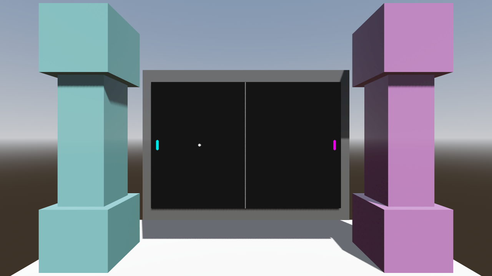

# walker-viewport-2d-in-3d — Game Design Document (recovered)

| | |
|---|---|
| Version | 0.1.0-recovered |
| Date | 2026-09-27 |
| Author | Zelda (agent, silent) for Nik Bear Brown |
| Mode | recovered, silent |
| Revision | 1 |
| Gates | vision ○ · systems ○ · world ○ · scope ○ (none signed) |
| Source | `godot/` (Walker adaptation of Godot demo `viewport/2d_in_3d`, upstream commit a3b5c113112f77291d5f3d1360f33a882fdc52f7 per `README.md:3-4`) |

gate — unsigned at time of writing

Provenance tags: `[OBSERVED path:line]` the file does this (paths relative to the project folder) · `[INFERRED]` the code strongly implies this, evidence stated · `[MISSING → Q-xx]` nothing in the folder can answer this; logged in `design/decisions.md`. Tuning numbers are observed values, not approved design. "Verified" is used only where `VERIFICATION.md` or `FRICTIONAL.md` records a run; everything else is source observation. No `*.log` files exist in this folder; the run records are the prose entries in those two files.

*`[OBSERVED godot/screenshots/2d_in_3d.webp]` upstream screenshot referenced by `godot/README.md:22`. It shipped with the upstream demo; it is not a Walker capture and does not verify that this adaptation renders (`VERIFICATION.md:23-25`).*

## 1. Vision summary

**What this is.** A tech demo, not a game. It shows one rendering technique: a 2D scene drawn into a `SubViewport`, whose `ViewportTexture` is assigned as the albedo texture of a quad in a 3D scene `[OBSERVED godot/2d_in_3d.gd:11-15; godot/2d_in_3d.tscn:71-81]`. The 2D scene happens to be a minimal two-player Pong `[OBSERVED godot/pong.gd:1-70]`. The upstream description says exactly that and nothing more `[OBSERVED godot/project.godot:14; godot/README.md:3]`.

**Why it is in Walker.** The folder says only that it is an independent adaptation of the upstream demo with the title changed and a local paddle clamp added `[OBSERVED README.md:3-5, 11-13; FRICTIONAL.md:3-5]`. What it is meant to teach or prove for Walker is `[MISSING → Q-01]`.

**Player / audience.** `[MISSING → Q-02]`. The controls imply two people sharing one keyboard `[INFERRED: two independent action pairs, godot/project.godot:26-45]`; that is an input layout, not an audience.

**Ghost Center.** Expected and present. There is no stated fantasy, no stated goal for a player, no pillar. The code's structure suggests the vision was "prove a live, interactive 2D scene survives the trip onto a 3D surface" `[INFERRED: the only non-Pong script sets the texture and animates the camera, godot/2d_in_3d.gd:9-23; the tests check texture identity and live input, godot/test_input.gd:20-33]`.

## 2. Design pillars

None stated anywhere in the folder `[MISSING → Q-03]`. I will not invent them. Candidate pillars a human could adopt, all `[INFERRED]` from what the code protects: (a) the 2D scene is live, not a baked image (`render_target_update_mode = 4`, `godot/2d_in_3d.tscn:78`); (b) the 2D scene does not know it is in 3D (Pong reads only its own viewport rect, `godot/pong.gd:18`); (c) minimal diff from upstream (`FRICTIONAL.md:43-44`).

## 3. Core loop

Two loops run every frame, one inside the other `[OBSERVED]`:

1. **Pong loop (2D, inside the SubViewport).** Ball integrates → roof/floor flip → paddle hit reverses x, speeds up ×1.1, randomizes y → miss resets to centre → paddles move from input and are clamped `[OBSERVED godot/pong.gd:22-70]`.
2. **Presentation loop (3D).** The SubViewport re-renders `[INFERRED: update mode 4 is UPDATE_ALWAYS in Godot 4's enum; godot/2d_in_3d.tscn:78]` → its texture is already bound to the quad material (bound once at `_ready`, `godot/2d_in_3d.gd:15`) → the camera sways on a sin/cos idle `[OBSERVED godot/2d_in_3d.gd:18-23]`.

There is no outer loop: no score, no match end, no menu, no restart other than the miss reset `[OBSERVED absence: no score variables or UI in godot/pong.gd or godot/2d_in_3d.tscn]`. Whether Pong should have a score or win condition is `[MISSING → Q-05]`.

See `diagrams/viewport-flow.svg` and `diagrams/pong-loop.svg`.

## 4. Player Experience Goals

None stated `[MISSING → Q-04]`. Mechanic Mirage is not even available here: there are no PX goals to confuse with features. The only experience claim anywhere is the upstream one-liner "a 2D scene can be shown within a 3D scene" `[OBSERVED godot/README.md:3]`, which is a technique description, not a player experience.

## 5. Mechanics

### M-01 Ball motion `[OBSERVED godot/pong.gd:24-29, 48]`
Position integrates `direction * ball_speed * delta` per `_process` frame. No physics bodies: the ball is a `Sprite2D` moved by `set_position` `[OBSERVED godot/2d_in_3d.tscn:87-89; godot/pong.gd:48]`. Initial speed `INITIAL_BALL_SPEED = 80.0` `[OBSERVED godot/pong.gd:4]`, initial direction `Vector2.LEFT` `[OBSERVED godot/pong.gd:10]`, start (300, 200) `[OBSERVED godot/2d_in_3d.tscn:88]`.

### M-02 Roof / floor bounce `[OBSERVED godot/pong.gd:31-33]`
Flip `direction.y` when the ball centre passes y < 0 moving up or y > screen height moving down. Verified headless: session 97299 observed roof and floor reversals `[OBSERVED FRICTIONAL.md:47-49]`; an earlier 30 s run (60598) saw no roof reversal before timeout and exited 1 `[OBSERVED FRICTIONAL.md:39-44]`.

### M-03 Paddle hit `[OBSERVED godot/pong.gd:35-40]`
If the ball centre is inside a paddle rect while moving toward it: reverse x, `ball_speed *= 1.1`, `direction.y = randf() * 2.0 - 1`, normalize. Paddle rect size comes from the left paddle texture (8×32) and is reused for both `[OBSERVED godot/pong.gd:19, 25-26; godot/left_pallete.png is 8x32]`. Verified headless: natural left-paddle rebound with speed 88 and unit direction `[OBSERVED VERIFICATION.md:8-9; FRICTIONAL.md:31-33]`; right-paddle reversal in session 97299 `[OBSERVED FRICTIONAL.md:47-49]`.
Speed has no cap `[OBSERVED: no clamp on ball_speed anywhere in godot/pong.gd]`. Whether that is intended is `[MISSING → Q-06]`; see R-02.

### M-04 Miss and reset `[OBSERVED godot/pong.gd:42-46]`
Ball centre leaving x < 0 or x > width resets to screen centre, speed 80, direction (-1, 0). The serve always goes left, whoever missed `[OBSERVED godot/pong.gd:46]`. Verified headless: reset to (300, 200), speed 80, leftward after an input-driven miss `[OBSERVED VERIFICATION.md:9-10; FRICTIONAL.md:33-35]`.

### M-05 Paddle movement `[OBSERVED godot/pong.gd:50-70]`
`PAD_SPEED = 150` px/s `[OBSERVED godot/pong.gd:3]`. Left paddle: `left_move_up` / `left_move_down`; right: `right_move_up` / `right_move_down` `[OBSERVED godot/pong.gd:53-56, 64-67]`. Movement is gated on the centre being inside (0, height), then clamped after integration to 0..height `[OBSERVED godot/pong.gd:58-59, 69]`. The clamp is the one Walker runtime change; it fixed an observed overshoot (y = -0.916/-0.444 and 400.625/400.055) and keeps the upstream centre-bound convention, not whole-sprite containment `[OBSERVED FRICTIONAL.md:23-27; VERIFICATION.md:16-18]`. Verified headless: all four directions move the right paddle about 21.7–22.4 px over a 150 ms hold, and 3 s holds end with centres exactly 0 and 400 `[OBSERVED FRICTIONAL.md:15-18, 26-27]`. Whether the centre convention is the intended one is `[MISSING → Q-07]`.

### M-06 Camera idle `[OBSERVED godot/2d_in_3d.gd:4, 18-23]`
`CAMERA_IDLE_SCALE = 0.005` rad amplitude. x uses cos, y and z use sin, all offset from `camera_base_rotation.y`, not from each axis's own base `[OBSERVED godot/2d_in_3d.gd:21, 23]`. With the camera's identity rotation `[OBSERVED godot/2d_in_3d.tscn:68]` all three base components are 0, so the quirk has no visible effect today `[INFERRED]`. Keep or fix is `[MISSING → Q-08]`. Visible appearance of the idle is unverified `[OBSERVED VERIFICATION.md:23-25]`.

## 6. Systems

### S-01 SubViewport render-to-texture `[OBSERVED]`
`SubViewport` 600×400, `render_target_update_mode = 4` `[OBSERVED godot/2d_in_3d.tscn:76-78]`; clear mode set to `CLEAR_MODE_ONCE` at runtime `[OBSERVED godot/2d_in_3d.gd:12]`; `viewport.get_texture()` assigned to `ViewportQuad.material_override.albedo_texture` `[OBSERVED godot/2d_in_3d.gd:15]`. The quad is a `PlaneMesh` scaled 2 × 1.333, a 3:2 aspect that matches 600×400 `[INFERRED from godot/2d_in_3d.tscn:72-74, 77]`. Verified headless: material texture is identical to `SubViewport.get_texture()`, and Pong reads 600×400 `[OBSERVED VERIFICATION.md:6-7; FRICTIONAL.md:17-18]`. Pixels on the quad are not verified `[OBSERVED VERIFICATION.md:23-25; README.md:14]`.

### S-02 Pong simulation `[OBSERVED godot/pong.gd]`
Frame-rate `_process`, not `_physics_process`; collisions are `Rect2.has_point` on the ball centre `[OBSERVED godot/pong.gd:22, 25-26, 36]`. `screen_size` defaults to 640×400 and is replaced by the viewport rect at `_ready` `[OBSERVED godot/pong.gd:7, 18]`.

### S-03 Input map `[OBSERVED godot/project.godot:24-45]`
Four actions bound by physical keycode, deadzone 0.2: W (87), S (83), Up (4194320), Down (4194322).

### S-04 3D stage `[OBSERVED godot/2d_in_3d.tscn:103-165]`
Floor plane, two three-part pillars (teal and violet materials), a grey back box behind the quad, procedural sky environment, one shadowed `DirectionalLight3D` at energy 0.15. Decorative framing; nothing scripts it.

Absent systems `[OBSERVED absence]`: no autoloads, no `[layer_names]`, no signals, no `class_name`, no `@export`, no RPCs, no save/load, no scene transitions (grep of `godot/*.gd` and `godot/project.godot`).

## 7. Progression

N/A. There is no score, level, unlock, or session end `[OBSERVED absence, godot/pong.gd]`. The only thing that escalates is ball speed within a rally (M-03), and it resets on a miss (M-04). That is difficulty drift, not progression.

## 8. World

N/A. The 3D scene is a stage for the quad: floor, pillars, backdrop, sky `[OBSERVED godot/2d_in_3d.tscn:103-165]`. No world rules beyond the viewport contract (S-01).

## 9. Narrative

N/A. No text, dialogue, or story content exists in scenes or scripts `[OBSERVED absence]`. None is implied by the demo's purpose `[OBSERVED godot/project.godot:14]`.

## 10. Characters

N/A. Two paddles, one ball, no named entities `[OBSERVED godot/2d_in_3d.tscn:87-97]`.

## 11. Features and priority

Priorities below are Zelda's recovered reading of what the demo cannot lose; approval is `[MISSING → Q-09]`.

| ID | Feature | Code | Priority | Status |
|---|---|---|---|---|
| F-01 | 2D Pong rendered in a SubViewport | `godot/2d_in_3d.tscn:76-101` | CORE | implemented; size verified headless |
| F-02 | ViewportTexture bound to the 3D quad | `godot/2d_in_3d.gd:11-15` | CORE | implemented; texture identity verified headless; pixels unverified |
| F-03 | Two-player keyboard paddles | `godot/project.godot:24-45`, `godot/pong.gd:50-70` | CORE | implemented; verified headless |
| F-04 | Pong rules: bounce, speed-up, miss reset | `godot/pong.gd:28-48` | CORE | implemented; verified headless incl. one full rally run |
| F-05 | Post-integration centre clamp (Walker change) | `godot/pong.gd:58-59, 69` | IMPORTANT | implemented; verified headless |
| F-06 | 3D stage (pillars, floor, light, sky) | `godot/2d_in_3d.tscn:103-165` | NICE | implemented; unverified visually |
| F-07 | Camera idle sway | `godot/2d_in_3d.gd:18-23` | NICE | implemented; unverified visually |
| F-08 | Headless test harness | `godot/test_input.gd`, `test_ball.gd`, `test_rally.gd` | IMPORTANT | present; results recorded in `VERIFICATION.md` |

**CORE = 4 / 8 = 50%.** Over the 40% line. Re-prioritization attempted: demoting F-04 (Pong rules) to IMPORTANT gives 3/8 = 37.5%, but then the "live interactive 2D scene" claim rests on paddles moving over a frozen ball, which is a weaker demo. Two options, recorded in Q-09: (1) cut F-04 to IMPORTANT and accept the reduced MVP (the viewport technique alone); (2) keep all four CORE and accept the overage, which for a single-technique demo costs nothing but a rule exception. Timeline: `[MISSING → Q-13]`. I have not decided; tags left as recovered.

## 12. Out of scope

Observed absent, and nothing in the folder asks for them `[OBSERVED absence]`: scoring, win/lose, menus, AI opponent, sound, networking, gamepad or touch bindings, mouse/touch input forwarded through the quad into the SubViewport. The last one is the natural next feature for a 2D-in-3D demo; whether it is in or out is `[MISSING → Q-12]`.

## 13. Technical

- Engine: Godot, `config/features` "4.7" `[OBSERVED godot/project.godot:17]`; headless runs used Godot 4.7.2 `[OBSERVED FRICTIONAL.md:6; VERIFICATION.md:5]`.
- Renderer: `gl_compatibility` desktop and mobile; MSAA 3D = 2; soft shadow quality 4 `[OBSERVED godot/project.godot:47-52]`.
- Main scene `res://2d_in_3d.tscn`; title "Walker 2D in 3D" `[OBSERVED godot/project.godot:13, 16]`.
- Warnings: `gdscript/warnings/untyped_declaration=1` `[OBSERVED godot/project.godot:22]`.
- Scripts: `2d_in_3d.gd` extends Node3D, `pong.gd` extends Node2D; tests extend SceneTree `[OBSERVED godot/2d_in_3d.gd:1; godot/pong.gd:1; godot/test_input.gd:1; godot/test_ball.gd:1; godot/test_rally.gd:1]`.
- Diff from upstream: title, the paddle clamp, and the three test scripts `[OBSERVED FRICTIONAL.md:4-5, 43-44; godot/test_*.gd present]`. Whether Walker should stay minimal-diff or fix upstream quirks (M-06, R-02) is `[MISSING → Q-14]`.
- License: MIT, Godot Engine contributors `[OBSERVED LICENSE.md:1-21]`.
- Films: two narrated 4K films are planned and do not exist `[OBSERVED README.md:14-15; VERIFICATION.md:21-30]`. What they must show beyond the evidence list in `VERIFICATION.md:23-27`, and who accepts them, is `[MISSING → Q-10]`.

## 14. Risks

| ID | Risk | Evidence | Mitigation |
|---|---|---|---|
| R-01 | The one thing the demo exists to show, pixels of the 2D game on the 3D quad, has never been seen by this pipeline. A bound texture object is not visible output. | `VERIFICATION.md:23-25`; `README.md:14-15` | T-04 pixel readback; the recording blocker must clear first `[MISSING → Q-11]` |
| R-02 | Unbounded ×1.1 speed-up plus centre-point `has_point` on an 8 px paddle: past about 480 px/s at 60 fps the ball steps more than 8 px per frame and can tunnel through a paddle. That is roughly 19 consecutive hits from 80. | `[INFERRED from godot/pong.gd:4, 36-38; 8 px paddle width]` | T-05; decide Q-06 |
| R-03 | Rally coverage is random: one 30 s run missed the roof bounce and exited 1. | `FRICTIONAL.md:39-44`; `VERIFICATION.md:13-14` | T-07 seeded rally |
| R-04 | The only image in the folder is upstream's screenshot; easy to mistake for Walker evidence. | `godot/README.md:20-22` | Caption it as upstream everywhere (done in this GDD and the deck) |
| R-05 | Camera idle axis quirk becomes visible the moment anyone rotates the camera in the scene. | `godot/2d_in_3d.gd:21, 23`; `godot/2d_in_3d.tscn:68` | Q-08 |

## 15. Open questions

Fourteen, all in `design/decisions.md` as Q-01..Q-14. The two that block anything useful: Q-01 (why this demo is in Walker) and Q-11 (what clears the visible-recording blocker).

## 16. Tests

Existing `[OBSERVED]`:

| ID | Script | What it checks | Recorded result |
|---|---|---|---|
| T-01 | `godot/test_input.gd` | real W/S/Up/Down events move the correct paddle the correct way (lines 23-33); quad texture == SubViewport texture (line 20); Pong reads 600×400 (line 21); 3 s simultaneous holds keep centres in 0..400 (lines 36-46) | pass, exit 0 `[OBSERVED FRICTIONAL.md:15-19, 25-28]` |
| T-02 | `godot/test_ball.gd` | natural left-paddle rebound at speed 88 with unit direction (lines 8-15); input-driven miss resets to (300, 200), 80, LEFT (lines 17-34) | pass, session 44739 exit 0 `[OBSERVED FRICTIONAL.md:31-36]` |
| T-03 | `godot/test_rally.gd` | 30 s state-feedback controller sending only key events; looks for right-paddle, roof and floor reversals (lines 14-32) | 60598 exit 1 (no roof), 97299 exit 0 `[OBSERVED FRICTIONAL.md:39-48]` |

Proposed (none exist):

| ID | Test | Why |
|---|---|---|
| T-04 | GPU pixel readback: render one frame with a windowed/offscreen renderer, sample the quad's screen region, assert paddle/ball colours appear | closes R-01; the demo's actual claim |
| T-05 | High-speed tunnelling: drive a rally to 20+ hits (input only) and assert no pass-through | R-02 / Q-06 |
| T-06 | Camera idle bounds: rotation stays within ±0.005 rad of base on every axis | M-06 / Q-08 |
| T-07 | Seeded rally: call `seed()` before the run so coverage of roof/floor/right is reproducible | R-03 |
| T-08 | Human capture at original speed with logs kept beside it, per `VERIFICATION.md:26-27` | the film prerequisite; human playtests on record: 0 |

## Zelda's notes (silent mode; what I would have said out loud)

**7 Failure Mode audit**

1. **Ghost Center — present, expected.** §1 and §2 are empty of intent. For a tech demo that is survivable; for a Walker entry it is not, because nobody can say whether this folder is finished until Q-01 says what it is for.
2. **Mechanic Mirage — not applicable.** No PX goals exist to be mistaken for features (§4). Q-04.
3. **Implementation Void — partly.** The tests are unusually honest about edges (overshoot, miss, roof). The unhandled edge is speed growth (R-02). Nobody has looked at the unhappy path of rendering at all.
4. **Priority Inflation — 50% CORE.** Real, but cheap here: four CORE features in a 93-line codebase. Q-09 has both options.
5. **Novelist's Trap — clean.** No lore anywhere. Keep it that way.
6. **Completeness Fallacy — the big one.** The state checks all pass, and it would be easy to read that as "done". The folder itself refuses that reading three times (`README.md:9`, `VERIFICATION.md:24-25`, `FRICTIONAL.md:7`). The demo's whole claim is visual and nothing visual has been checked.
7. **Stagnant Artifact — mitigated.** `FRICTIONAL.md` is a dated log with session ids; this GDD starts `CHANGELOG.md`. No `.log` files back the session ids; keep them next to the next capture.

**Read.** This is a clean, small, well-tested-where-it-can-be adaptation of a one-trick demo. The trick is the part nobody has seen. **First fix:** answer Q-11 and run T-04. Until pixels on the quad exist, every other improvement is decoration on an unverified claim.
